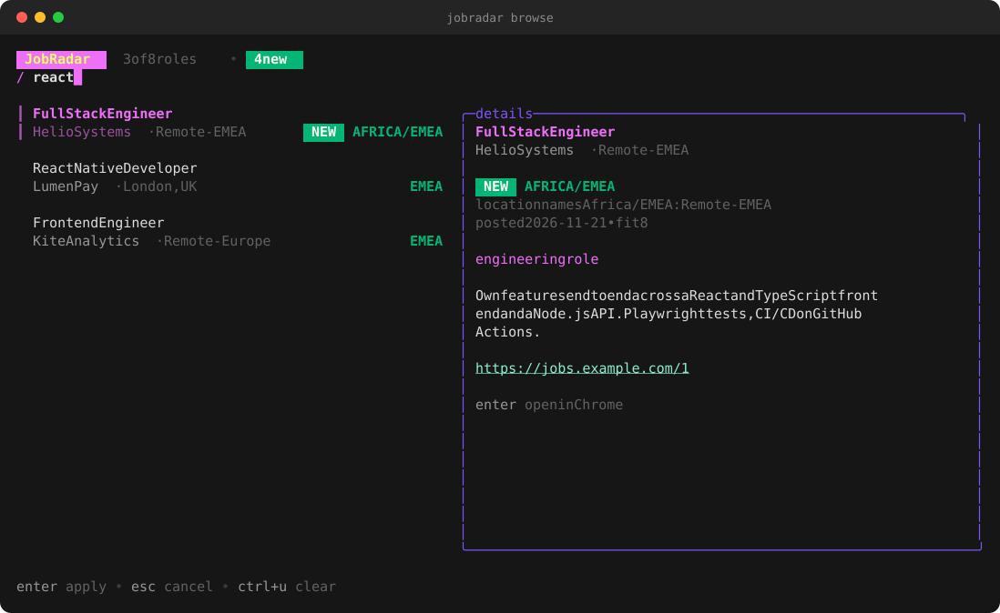
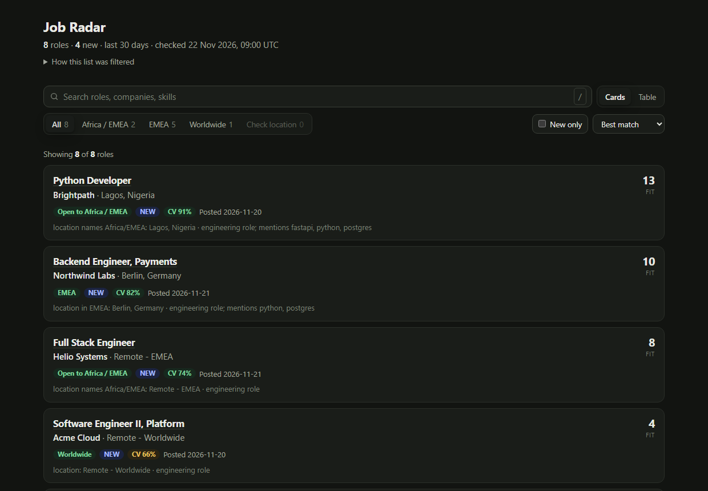
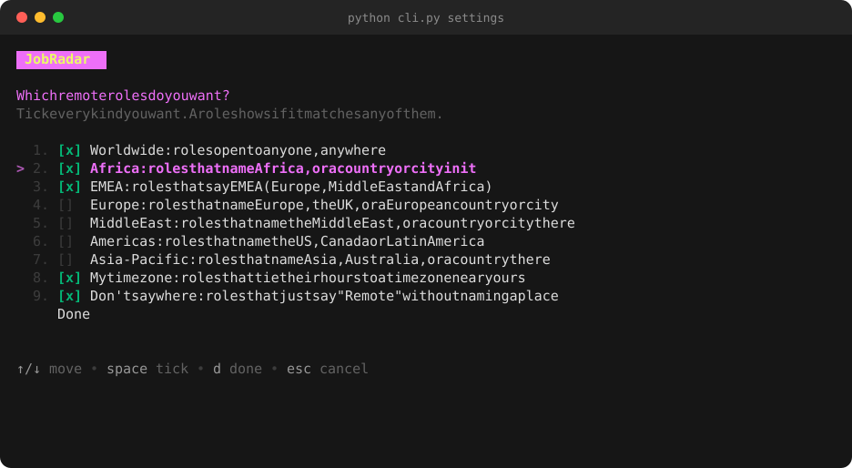
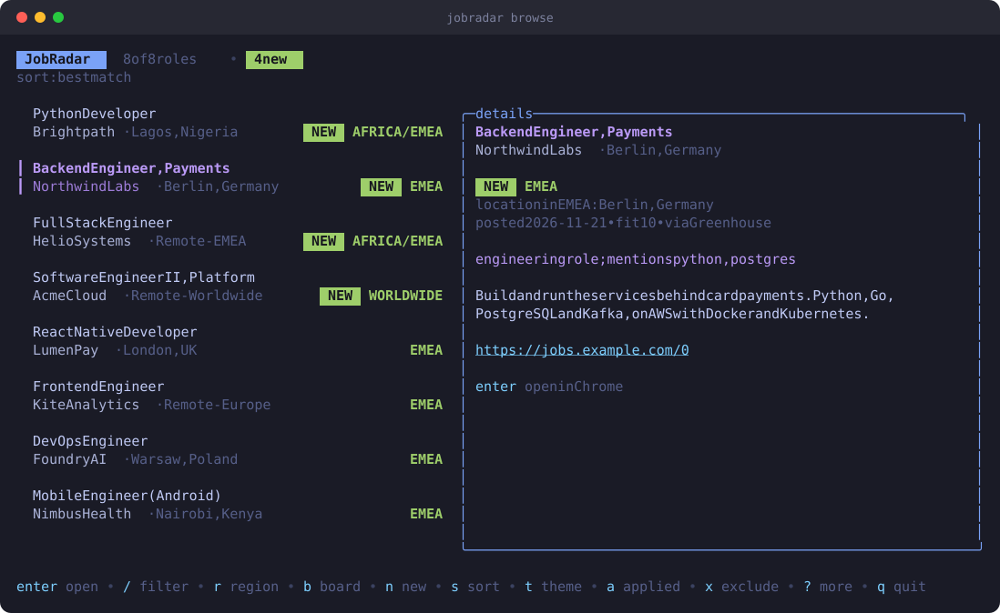
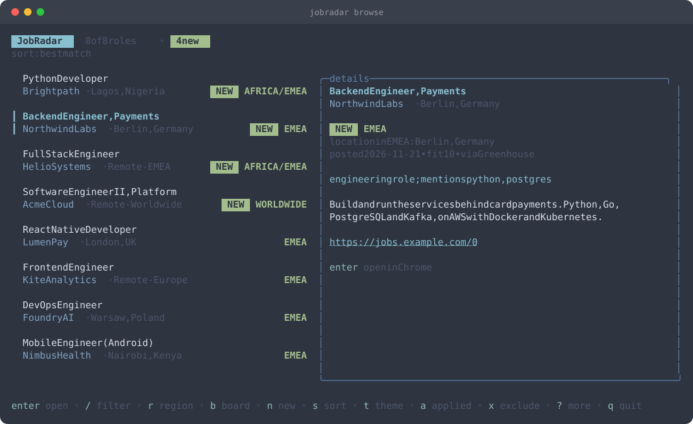

# Job Radar

**Find jobs you can actually take, remote or on-site, anywhere in the world, across thousands of companies, in one place, from your terminal.**

Job Radar reads the job boards that companies publish themselves, keeps the roles that fit you, and shows them in a full-screen browser or a web page. Remote or on-site, one country or the whole world: you decide. It is free, needs no account or API key, and has nothing to install except Python.

> **Credit.** Job Radar started as [OsasDTEch/jobradar](https://github.com/OsasDTEch/jobradar). The idea, the job-board readers, the region check, the fit score and the first report are all from that project. This version builds on it. See [Credits](#credits).

<p align="center">
  
</p>

---

## Contents

- [What it does](#what-it-does)
- [Quick start](#quick-start)
- [Three ways to look at your results](#three-ways-to-look-at-your-results)
- [Make it yours: settings](#make-it-yours-settings)
- [Which remote roles you get](#which-remote-roles-you-get)
- [Time zones and on-site roles](#time-zones-and-on-site-roles)
- [Find more jobs](#find-more-jobs)
- [Start over: reset](#start-over-reset)
- [If a search is stopped](#if-a-search-is-stopped)
- [What grows, and what doesn't](#what-grows-and-what-doesnt)
- [How it decides what to show](#how-it-decides-what-to-show)
- [Themes](#themes)
- [Command line cheat sheet](#command-line-cheat-sheet)
- [Your system: Windows, WSL, macOS and Linux](#your-system-windows-wsl-macos-and-linux)
- [Updating](#updating)
- [Troubleshooting](#troubleshooting)
- [Run it every morning](#run-it-every-morning)
- [Files in this project](#files-in-this-project)
- [Contributing and tests](#contributing-and-tests)
- [Credits](#credits)
- [License](#license)

---

## What it does

1. **Collects jobs** from the public job boards behind [Greenhouse](https://boards-api.greenhouse.io), [Lever](https://api.lever.co/v0/postings) [Ashby](https://api.ashbyhq.com/posting-api/job-board) and [Gem](https://jobs.gem.com), plus the job sites Remotive, Arbeitnow, Jobicy, Himalayas, RemoteOK and Hacker News "Who is hiring?".
2. **Keeps the ones that fit you.** You choose the kind of role, which kinds of remote role you want (or on-site roles instead, or as well, in the places you name or anywhere), and how far back to look. Roles you have applied to, and companies you have ruled out, never show up.
3. **Scores them against your CV**, if you give it one, so you can see which roles match the skills you actually have. A CV is optional: without one, everything still works, you just don't get the match scores.
4. **Shows you what is new** since the last time you looked.

It never applies for anything. It only finds and sorts.

---

## Quick start

You need **Python 3.10 or newer**. Nothing else.

**1. Install it.** Pick one way.

The easiest is [pipx](https://pipx.pypa.io) or [uv](https://docs.astral.sh/uv/). Either one installs Job Radar as a command, in its own space, so it can't clash with anything else on your computer:

```bash
pipx install "jobradar[pdf] @ git+https://github.com/Desmond123-arch/jobradar.git"
# or
uv tool install "jobradar[pdf] @ git+https://github.com/Desmond123-arch/jobradar.git"
```

`[pdf]` adds PDF CV reading. On Windows, use `[all]` to also get the full-screen browser. To update later, run `pipx upgrade jobradar` or `uv tool upgrade jobradar`. To remove it, run `pipx uninstall jobradar` or `uv tool uninstall jobradar`.

Don't have pipx or uv? Plain `pip` works too, ideally inside a virtual environment:

```bash
pip install "jobradar[pdf] @ git+https://github.com/Desmond123-arch/jobradar.git"
```

Or get the code and run it from the folder:

```bash
git clone https://github.com/Desmond123-arch/jobradar.git
cd jobradar
```

**2. Start it**

```bash
jobradar            # if you installed it
python cli.py       # if you're running it from the folder
```

On macOS and Linux you may need `python3` instead of `python`. An installed copy also has `jobradar-search`, which does the same as `python jobradar.py` and takes the same flags, and `jobradar-cv cv.pdf`, which lists the skills found in your CV.

**Where your files live.** Run from the folder, everything stays in the folder, as before. Installed, your company list, settings, results and report live in `~/.jobradar` (`C:\Users\you\.jobradar` on Windows). The first run copies the starter company list there. To use a different folder, set `JOBRADAR_HOME`.

**3. Answer a few questions.** The first time, it asks about your CV, the roles you want, which kinds of remote role you want, your time zone (it starts on this computer's) and your colors. You can change every answer later.

<p align="center">
  
</p>

**4. Choose "Search for jobs".** It shows a short summary of your saved settings and the first choice is **Search now**, so one Enter runs it. You are never made to answer the questions again: change a few answers for one search, or edit the saved settings, only if you want to. The screen clears and a progress bar shows how far along it is. When it finishes, read the summary, press **Enter**, and choose **Browse the last results**.

That is all. Run it again tomorrow and anything new is marked **NEW**.

> **Reading a PDF CV** needs one small add-on, `pypdf`. Installing with `[pdf]` as above already includes it; from a folder, run `pip install pypdf`. Word (`.docx`) and text (`.txt`) CVs need nothing.

---

## Three ways to look at your results

### 1. The full-screen browser

Choose **Browse the last results** in the menu, or run `python cli.py browse`. Move with the arrow keys, and press **Enter** to open the posting in your browser.

<p align="center">
  
</p>

| Key | What it does |
|-----|--------------|
| `↑` `↓` (or `j` `k`) | Move. `PgUp` `PgDn` (or Space) to page, `g` `G` for top and bottom |
| `Enter` | **Open the posting in your browser** |
| `/` | Filter as you type. Several words must all match. `"in quotes"` keeps a phrase. `-word` leaves a word out |
| `r` | Cycle through the kinds of role in your list: Africa, EMEA, Worldwide, Check location and so on |
| `b` | Cycle through the **job boards** in your results: Greenhouse, Lever, Ashby, Gem, Hacker News and so on. Combines with `r` |
| `n` | Show only new roles |
| `s` | Cycle the sort: best match, fit score, newest, company |
| `a` | Mark as applied. It is saved and hidden from now on |
| `x` | Exclude this company for good |
| `t` | Change the color theme |
| `c` | Clear all filters |
| `d` | Hide or show the details panel (it needs a wide window) |
| `?` | Show every key |
| `Esc` | Clear the filters, then quit. `q` quits straight away |

**With the mouse.** Everything above also works by clicking, in the menus too:

| Do this | To get this |
|---------|-------------|
| Click a role | Select it |
| Double-click a role | Open the posting |
| Click the link (or "enter open in ...") in the details panel | Open the posting |
| Scroll the wheel | Move up and down the list. In a menu, it moves the highlight |
| Click a hint along the bottom (`region`, `board`, `new`, `sort`, `theme`, `applied`, `exclude`, `quit` and the rest) | Do exactly what pressing that key does. In a narrow window the least important hints are left out first; `?` always lists every key |
| Click an option in any menu | Choose it |

A mouse also steals the terminal's normal click-and-drag text selection. To copy text, hold **Shift** while you drag (in most terminals), or switch the mouse off: set **Mouse** to *off* in Settings, or run with `JOBRADAR_MOUSE=0`. It uses the standard xterm mouse protocol, which most modern terminals understand. In tmux, if clicks do nothing, try `tmux set -g mouse on`.

### 2. The web report

Every search writes **`report.html`**: a page you open in any browser, with search, a card or table view, sorting, and two rows of filter buttons: the **kind of remote role** and the **job board** (Greenhouse, Lever, Hacker News and so on). Each button shows how many roles it would leave, and the two rows work together, so you can ask for "Africa roles from Ashby". Every card says which board it came from, and typing a board's name in the search box finds its roles. Roles show a **CV %** badge when you have set a CV. Turn on **Open report after run** in Settings and it opens by itself when a search finishes.

<p align="center">
  
</p>

### 3. Plain data

`jobs.json` holds the same roles as data, if you want to sort or filter them with your own tools.

---

## Make it yours: settings

Choose **Settings** in the menu, or run `python cli.py settings`. Everything is saved to a file called `settings.json`, so you never have to edit it by hand.

<p align="center">
  
</p>

| Setting | What it does | Choices |
|---------|--------------|---------|
| **CV file** | Your CV. Jobs are scored against the skills in it, and the role filter follows them | Pick from the list it finds, or paste a path |
| **Roles** | Which job titles to keep | AI and engineering · match my CV · web and software · every role |
| **Remote roles** | Which kinds of remote role you want. A checklist: see [Which remote roles you get](#which-remote-roles-you-get) | tick any of nine kinds |
| **Time zone** | Where you are. Pick from a scrolling list, or leave it on *auto* to use this computer's | auto · UTC-12 to UTC+14, with cities |
| **Time zone range** | How many hours from your zone you are happy to work | same zone · within 1 to 12 hours · any (no filter). Default 3 |
| **On-site roles** | Also keep on-site and hybrid roles, not only remote ones | yes / no |
| **On-site places** | Where you would work on-site, for example `Accra, Ghana`. Blank means anywhere | text |
| **Companies** | How wide to search | `companies.txt` only · plus job sites · every board it can find |
| **Drop senior titles** | Hide senior, staff, lead and manager roles | yes / no |
| **Show locked roles** | Also show roles limited to places you cannot work from | yes / no |
| **Look back (days)** | How old a posting can be | 1 to 365, default 30 |
| **Browser** | Which browser opens links | automatic, `chrome`, `default`, or your own command |
| **Color theme** | The look of the terminal screens | [seven themes](#themes) |
| **Open report after run** | Open `report.html` when a search finishes | yes / no |
| **Mouse** | Click and scroll in the full-screen screens. Off lets you select and copy text normally | on / off |

**Choosing your CV.** The picker looks for files with "cv" or "resume" in the name in this folder, your home folder, Downloads, Documents and Desktop (and the Windows side if you use WSL), newest first. Pick one, or paste a path. Windows paths such as `C:\Users\me\Downloads\cv.pdf` work. It reads the file straight away and shows the skills it found, so you know it worked.

**Good to know.**
- Anything you type on the command line beats the settings file. `--no-settings` ignores the file for one run.
- A missing or wrong value falls back to the default. A typo cannot stop a search.
- `settings.example.json` shows what the file looks like.

---

## Which remote roles you get

Job sites let you tick the kinds of remote job you want. So does Job Radar. Open **Settings → Remote roles** (or answer it when you start a search) and tick any you like. **A role shows if it matches any box you ticked.** Worldwide is just one box, so you do not need it.

<p align="center">
  
</p>

| Box | Shows remote roles that... | Examples of what they say |
|-----|----------------------------|---------------------------|
| **Worldwide** | are open to anyone, anywhere | "Remote - Worldwide", "Anywhere", "Global" |
| **Africa** | name Africa, or a country or city in it | "Remote, Africa", "Remote, Nigeria", "Remote - Accra" |
| **EMEA** | say EMEA (Europe, the Middle East and Africa) | "Remote - EMEA" |
| **Europe** | name Europe, the UK, or a European country or city | "Remote, Germany", "Remote, UK" |
| **Middle East** | name the Middle East, or a country or city there | "Remote, Dubai", "Remote - Saudi Arabia" |
| **Americas** | name the US, Canada or Latin America | "Remote - US only", "Remote, Canada", "LATAM" |
| **Asia-Pacific** | name Asia, Australia, or a country there | "Remote, India", "APAC", "Remote - Sydney" |
| **My time zone** | tie their hours to a time zone near yours | "Remote (CET)", "Overlap with CET required", "UTC-5 to UTC+2". See [time zones](#time-zones-and-on-site-roles) |
| **Don't say where** | just say "Remote" without naming a place | "Remote". They are flagged **Check location** |

A few things worth knowing:

- **A role can be in several boxes.** "Remote - US or Europe" is Americas *and* Europe, so it shows if you ticked either. An **EMEA** role is also open to Africa, Europe and the Middle East, so ticking any of those shows it too.
- **Nothing is assumed.** Untick Worldwide and "Remote - Worldwide" disappears. Tick only Africa and you get only Africa. The default is Worldwide, Africa, EMEA, My time zone and Don't say where.
- **Remote and on-site are separate.** These boxes only ever apply to *remote* roles. An on-site role, even in your own city, is never shown because of them. On-site and hybrid roles have their own switch, described next.
- **Hidden roles are not deleted.** Turn on **Show locked roles** to see them, labelled with the reason.
- **It reads wording.** "Remote - Germany" is read as Europe. A posting can mean something different from what it says, so open it and check before you apply.

---

## Time zones and on-site roles

**Time zones.** Many "remote" jobs are only remote for certain hours: "US Pacific hours", "overlap with CET required". Job Radar reads that wording and checks it against **your** time zone and the range you are happy with.

- **Your time zone** is set to *auto* by default, which means this computer's. A computer set to UTC+0 (Ghana, the UK, Senegal) gets UTC+0. Change it in **Settings → Time zone**, a scrolling list from UTC-12 to UTC+14 with cities beside each. If this computer's zone can't be read, it falls back to UTC+0.
- **Your range** is how many hours away you will work. The default is 3, so with UTC+0 a job on CET or SAST (1 to 2 hours) is fine, and one on PST or EST (5 to 8 hours) is hidden. Choose *Same time zone only*, up to 12 hours, or *Any* to switch the check off.

| The posting says | Result for someone on UTC+0, range 3 |
|------------------|--------------------------------------|
| `Remote (CET)`, `Overlap with CET required` | Kept. 1 hour away |
| `Remote (PST)`, `Must work EST hours`, `US hours` | Hidden. 8, 5 and 5 hours away |
| `Remote (UTC-5 to UTC+2)` | Kept. You are inside the range it asks for |
| `Remote, UTC+1 to UTC+3` | Hidden. A stated range must include you |
| `within 3 hours of UTC` | Kept |
| `any time zone`, `work from anywhere` | Kept |
| Nothing about time zones | Kept. No opinion, so no filter |

Hidden roles are not deleted. They are labelled **Other time zone** and show up if you turn on **Show locked roles**. A role that fits shows a short note ("time zone: CET (UTC+1), 1h from you") on its card. Only sentences about hours in a description are read, so "our offices are in London and New York" never rules a job out. It is wording matching, so it can be wrong: it saves you reading, it does not promise anything. It ignores `CST` and `IST`, because each name means two zones far apart.

**On-site roles.** By default you see **remote roles only**. Turn on **On-site roles** to also keep on-site and hybrid jobs wherever you say you would work. Name places (`Accra, Ghana`, or a country, or several separated by commas) to see only those, or **leave the places blank to see on-site jobs everywhere**. To see **only** on-site jobs, untick every kind of remote role in the checklist above. Put places in **On-site places**, such as `Accra, Ghana`, or a city and a country, separated by commas. Leave it blank for anywhere. Kept ones are labelled **On-site, included**. The time zone check does not apply to them, since you would be there.

---

## Find more jobs

Job Radar searches in three layers. Use as many as you like.

| Layer | What it covers | How to use it |
|-------|----------------|---------------|
| **Your list** | The companies in `companies.txt` | Paste a careers-page URL per line, or choose **Add a company** in the menu. To edit the file itself, see [editing a list](#editing-a-list) |
| **Job sites** | Remotive, Arbeitnow, Jobicy, Himalayas, RemoteOK and Hacker News | Settings → Companies → *plus job sites* |
| **Every board** | Thousands of companies, found for you | Settings → Companies → *every board* |

**Adding a company by hand.** Open `companies.txt` and add one line per company. The part after `|` is optional.

```
https://jobs.ashbyhq.com/somecompany | Some Company
https://jobs.lever.co/othercompany
https://jobs.gem.com/anothercompany
https://job-boards.greenhouse.io/thirdcompany
```

To find the right address, open a job posting and click Apply. If the address starts with `jobs.ashbyhq.com`, `jobs.gem.com`, `jobs.lever.co` or `job-boards.greenhouse.io`, that is the one.

<a id="editing-a-list"></a>

**Editing a list in a text editor.** Installed copies keep these files in `~/.jobradar` (or `C:\Users\you\.jobradar`), so run:

```
jobradar edit              # choose companies, exclude or applied
jobradar edit companies    # or name one
```

It is also in the menu as **Edit my lists in a text editor**. It opens the file, keeps the old one as `companies.txt.bak`, and when you close the editor says what changed and points out any `companies.txt` line it can't read. The editor is the first of: `JOBRADAR_EDITOR`, `VISUAL`, `EDITOR`; then Notepad on Windows, your default text editor on macOS, and `nano`, `micro`, `vim` or `vi` on Linux and WSL (WSL falls back to Windows Notepad). If none can start it prints the path so you can open the file yourself.

**"Every board" explained.** None of these platforms lets you search all their companies at once, so Job Radar finds company names from the Internet Archive's record of their pages, then checks each one. Many guesses are not real boards, and those are skipped quietly. The first scan takes a few minutes. After that the list is saved for 30 days.

**Keep track.** Add a line to `applied.txt` as `Company | Job title`, or press `a` in the browser, and that role never appears again. Add a company name to `exclude.txt`, or press `x`, to skip it completely.

---

## Start over: reset

Want a clean slate? Choose **Settings → Reset things...**, or run it from the command line:

```bash
python cli.py reset              # pick from a list
python cli.py reset seen         # or name what to reset
python cli.py reset all --yes    # --yes skips the "are you sure?" question
```

It always shows you exactly what it is about to do and asks first. Pressing Enter at the question means **no**.

| Reset | What it does |
|-------|--------------|
| `seen` | Forgets what you have seen, so every role shows as **NEW** again |
| `results` | Deletes the last results and report |
| `cache` | Deletes the saved list of boards, so the next search scans for them again |
| `settings` | Puts your settings back to the defaults |
| `applied` | Empties your applied list |
| `excluded` | Empties your excluded companies |
| `companies` | Restores the starter company list (installed copies only) |
| `all` | All of the above |

**Your work is not lost.** Before changing your settings, applied list, excluded list or company list, Job Radar copies each one to a `.bak` file next to it (`settings.json.bak`, `applied.txt.bak`, and so on), so one undo is always there. The files it can rebuild itself (results, the seen list, the board cache) are simply deleted. Your CV is never touched, and neither is `companies.txt` unless you ask for `companies`.

---

## What grows, and what doesn't

Job Radar keeps a few files, and none of them grow for ever.

| File | How it behaves over time |
|------|--------------------------|
| `jobs.json`, `report.html` | Rewritten on every search, so they only ever hold the last search's results. A search for every kind of role from every board can make them large (tens of megabytes), because every role is in them |
| `seen.json` | One short line per role you have been shown, so new ones can be marked **NEW**. A role is forgotten once no board has listed it for **90 days**, so the file follows the boards instead of growing every month. If a forgotten role is ever listed again it shows as new again |
| `discovered.json` | The list of company boards. It is rebuilt every 30 days, which also clears its list of boards that turned out not to exist |
| `applied.txt`, `exclude.txt`, `companies.txt` | Only what you add. [Reset](#start-over-reset) can empty them |
| `settings.json` | Tiny, and only changes when you change a setting |
| `*.bak`, `*.damaged`, `*.tmp` | At most one of each per file, overwritten rather than piled up. [Reset](#start-over-reset) removes any leftovers |

---

## If a search is stopped

You can press **Ctrl+C** during a search, or close the window, at any time.

- **Ctrl+C** stops it within a few seconds (it lets the requests already under way finish), says *"Stopped. Your results, seen list and settings are as they were."*, and leaves your files exactly as they were. Nothing is half-saved.
- **Closing the window** works the same way. Every file is saved in one step: a temporary copy is written first, then swapped in. So a file is either the old complete one or the new complete one, never a cut-off mix.
- **Results are saved at the very end.** A search stopped half way gives you no new results, but costs you nothing. Run it again. If it had already finished scanning for boards, that list is kept, so the second run is quicker.
- **The seen list is saved last.** If a run is cut off just before it, those roles simply show as **NEW** again, instead of being marked "seen" without you ever having been shown them.
- **If a file is ever damaged** anyway (a power cut, a full disk), Job Radar does not crash. It moves the bad `seen.json` aside as `seen.json.damaged`, tells you in the results, and carries on as if it were a first run.

---

## How it decides what to show

```
 your list ─┐
 job sites ─┼─►  collect jobs  ─►  keep roles that fit  ─►  check the place  ─►  score  ─►  show
 all boards ┘                       (title, how recent,       (is it open to      (skills
                                    not applied/excluded)     your region?)       on your CV)
```

Each role gets a label for where it can be done:

| Label | Meaning |
|-------|---------|
| **Worldwide**, **Africa**, **EMEA**, **Europe**, **Middle East**, **Americas**, **Asia-Pacific** | The kind of remote role it is, from its location. A role in several shows under the most specific one you ticked |
| **My time zone** | Its hours are tied to a time zone near yours |
| **Check location** | Says "Remote" with no place named. Read the posting |
| **On-site, included** | On-site or hybrid, in a place you listed, with **On-site roles** turned on |
| **Other time zone** | Remote, but its hours are too far from your time zone. Hidden unless you turn on **Show locked roles** |
| *Region locked, On-site* | Not a kind you ticked, or on-site and you did not allow it. Hidden unless you turn on **Show locked roles** |

Labels come from the posting's own words and can be wrong. Open the posting and check before you apply.

**Progress.** A long search shows a live bar for each step, with a count and a time estimate.

<p align="center">
  
</p>

---

## Themes

Seven color themes. The default, **Glow**, uses the colors from [Charm's Glow](https://github.com/charmbracelet/glow). Choose **Color theme** in Settings and the screen changes to each theme as you move over it, with a small sample list underneath, so you can see it before you decide. `Enter` keeps it and `Esc` puts the old one back. You can also press `t` while browsing to flip through them. Your pick is remembered.

<table>
  <tr>
    <td><br><sub>Catppuccin Mocha</sub></td>
    <td><br><sub>Tokyo Night</sub></td>
  </tr>
  <tr>
    <td><br><sub>Dracula</sub></td>
    <td><br><sub>Rosé Pine</sub></td>
  </tr>
  <tr>
    <td><br><sub>Gruvbox Dark</sub></td>
    <td><br><sub>Nord</sub></td>
  </tr>
</table>

Run `python cli.py themes` to see all seven side by side in your browser, using your own results. A terminal can only show 256 colors, so each theme is the closest match and looks a touch different from these pictures.

---

## Command line cheat sheet

Most people never need these, because the menu and settings cover them. They are here for scripts and for people who like flags.

```bash
python jobradar.py                   # search using your saved settings
python jobradar.py --remote africa,europe --days 7   # only roles naming Africa or Europe, last week
python jobradar.py --everything      # every kind of role, from every board and job site
python jobradar.py --open            # open report.html when it finishes

python cli.py edit companies         # open a list in a text editor (companies, exclude or applied)
python cli.py update                 # get the latest version (see Updating)
python cli.py reset                  # start over (see Start over)
```

| Flag | Effect |
|------|--------|
| `--days N` | Look back N days (default 30) |
| `--roles ai\|cv\|web` | Which titles to keep. `cv` follows the skills on your CV. `web` is backend, frontend, full-stack and software engineer |
| `--any-role` | Keep every kind of role |
| `--remote KINDS` | Which kinds of remote role to keep, separated by commas: `worldwide, africa, emea, europe, middle-east, americas, asia-pacific, my-timezone, unclear`. Default: `worldwide,africa,emea,my-timezone,unclear`. See [Which remote roles you get](#which-remote-roles-you-get) |
| `--emea` | The older shortcut for `--remote worldwide,africa,emea,europe,middle-east,my-timezone,unclear` |
| `--no-senior` | Drop senior, staff, principal, lead and manager titles |
| `--all` | Also show region-locked, on-site and other-time-zone roles |
| `--timezone ZONE` | Your time zone: `auto` (this computer, the default) or `UTC+1`, `UTC-8`, `UTC+5.5` |
| `--tz-range HOURS` | Hours from your zone you will work. Default 3. 24 or more turns the check off |
| `--onsite` | Also keep on-site and hybrid roles |
| `--places "Accra, Ghana"` | Where you would work on-site (blank: anywhere) |
| `--discover` | Also read every board found by discovery |
| `--refresh-discovery` | Scan for boards again now, instead of using the saved list |
| `--aggregators` | Also read the job sites |
| `--agg-pages N` | Pages to read per job site (default 5) |
| `--cv PATH` / `--no-cv` | Score against this CV / ignore any CV |
| `--everything` | Same as `--discover --aggregators --emea --any-role` |
| `--open` | Open the report in your browser when done |
| `--workers N` | Parallel requests (default 16) |
| `--out PATH` | Write the report somewhere else |
| `--no-settings` | Ignore `settings.json` for this run |

The menu has shortcuts too: `python cli.py browse`, `settings`, `themes`, `reset`, and `--plain` for simple numbered questions instead of the full-screen menu.

---

## Your system: Windows, WSL, macOS and Linux

Job Radar needs **Python 3.10 or newer** and works on all of these. Check yours with the command in the table.

| | **Windows** (PowerShell, cmd, Windows Terminal) | **WSL** (Linux inside Windows) | **macOS** | **Linux** |
|---|---|---|---|---|
| **Check Python** | `python --version` | `python3 --version` | `python3 --version` | `python3 --version` |
| **Get Python** | [python.org](https://www.python.org/downloads/) (tick "Add Python to PATH"), or `winget install Python.Python.3.12` | `sudo apt install python3` | [python.org](https://www.python.org/downloads/) or `brew install python`. The Python that comes with macOS is often too old | Your package manager, for example `sudo apt install python3` |
| **Start it** | `python cli.py` (or `py cli.py`) | `python3 cli.py` | `python3 cli.py` | `python3 cli.py` |
| **If installed with pipx** | `jobradar` | `jobradar` | `jobradar` | `jobradar` |
| **Full-screen mode** | Needs one add-on: `pip install windows-curses` (or install with `[all]`). Without it, **Browse** opens the web report instead | Built in | Built in | Built in |
| **Mouse** | Needs the add-on above | Built in | Built in | Built in |
| **Your files live** | The folder, or `C:\Users\you\.jobradar` if installed | The folder, or `~/.jobradar` if installed | The folder, or `~/.jobradar` if installed | The folder, or `~/.jobradar` if installed |

Notes for each:

- **Windows.** Use Windows Terminal or PowerShell. The progress bar and colors work in both, and on an old console that cannot draw block characters it falls back to a plain `####----` bar instead of failing. Windows paths such as `C:\Users\you\Downloads\cv.pdf` work everywhere a path is asked for. To install as a command: `pipx install "jobradar[all] @ git+https://github.com/Desmond123-arch/jobradar.git"`, where `[all]` adds the full-screen library and PDF reading.
- **WSL.** The full-screen browser, colors and mouse work as on Linux. Windows paths are converted for you, and the CV picker looks in your Windows Downloads, Documents and Desktop as well as your Linux home. Links open in a Windows browser, as described below.
- **macOS.** Terminal and iTerm2 both show the colors and take the mouse. Links open in your default browser.
- **Linux.** Links open in your default browser (through `xdg-open`), or in Chrome or Chromium if one is installed.
- **Over SSH, or any machine with no desktop.** Everything in the terminal works, including the full-screen browser. Nothing can open a browser there, so the link is shown instead: at the bottom of the screen when you press Enter on a role, and as a path after a search. Copy the link, or copy `report.html` to your own computer.

### What opens links, and what if you don't have Chrome

**You do not need Chrome.** Job Radar picks a browser in this order and uses the first one that works:

1. The `JOBRADAR_BROWSER` environment variable, if you set it.
2. **Settings → Browser**, if you set it.
3. **Chrome**, if it is installed (Windows, WSL, and Chrome or Chromium on Linux).
4. **WSL only:** your Windows default browser, through `wslview` if you have it, and otherwise through Windows itself. This works on every WSL install, so Edge, Firefox or anything else is used if that is your default.
5. Your system's **default browser**. On Windows that is often Edge, on macOS often Safari.

A text-mode browser such as `lynx` or `w3m` is never used, because it would take over the screen Job Radar is drawing on.

**To use a particular browser**, put its command in **Settings → Browser**. Put the whole path in quotes if it has spaces, and write `{url}` where the link goes (it is added at the end if you leave it out).

| Browser | What to enter in Settings → Browser |
|---------|-------------------------------------|
| Chrome, found automatically | `chrome` |
| Whatever your system uses | `default` |
| Edge on Windows | `"C:\Program Files (x86)\Microsoft\Edge\Application\msedge.exe" {url}` |
| Edge from WSL | `"/mnt/c/Program Files (x86)/Microsoft/Edge/Application/msedge.exe" {url}` |
| Firefox on Windows | `"C:\Program Files\Mozilla Firefox\firefox.exe" {url}` |
| Firefox on Linux or WSL | `firefox {url}` |
| Brave on Linux | `brave-browser {url}` |
| Chrome on macOS | `open -a "Google Chrome" {url}` |
| Firefox on macOS | `open -a Firefox {url}` |

`python openurl.py` prints which browser it would use right now.

**If no browser can be started** (a wrong command, or nothing installed), nothing breaks. The full-screen browser says "Couldn't open" and shows the link, **Open report.html** shows the file's path and says to open it yourself, and `--open` prints a message. Your results are always saved in `report.html` either way.

---

## Updating

```
jobradar update            # from a pipx, uv or pip install
python cli.py update       # from a folder
```

It tells you what is new, then asks before changing anything. `--check` only looks, and `--yes` skips the question.

| Installed as | What it runs |
|---|---|
| A folder (git clone) | `git pull --ff-only`. It stops, changing nothing, if you have uncommitted changes or are not on `main` |
| pipx | `pipx install --force` from GitHub |
| uv | `uv tool install --force` from GitHub |
| pip | `pip install --force-reinstall` from GitHub |

The version number doesn't change with every commit, so a plain "upgrade" would say you are up to date when you are not. That is why it forces a reinstall. Your settings, results and company list are kept, and so are the optional extras you already use.

On Windows an installed program can't replace itself while it is running, so `update` prints the exact command to run in a new window instead. Offline, it says so and changes nothing.

---

## Troubleshooting

**"No matching roles."** Widen the net: raise **Look back (days)**, turn on **Show locked roles**, switch **Roles** to *every role*, or set **Companies** to *every board*.

**"CERTIFICATE_VERIFY_FAILED" on every board (usually on a Mac).** Python from python.org comes with no security certificates until you install them, so it distrusts every website. Job Radar now borrows the ones your computer already has, so this should not happen. If you still see one line saying "requests failed ... can't check websites' security certificates", open **Finder > Applications > Python 3.x** and double-click **Install Certificates.command**, or run `python3 -m pip install certifi`, then try again. Job Radar never turns certificate checking off.

**"`jobradar` is not recognized" or "command not found".** pipx and uv put commands in a folder your terminal may not know yet. Run `pipx ensurepath` (or `uv tool update-shell`), then open a new terminal window. Until then, `python cli.py` from the folder always works.

**"Where did my settings and results go?"** An installed copy keeps them in `~/.jobradar` (`C:\Users\you\.jobradar` on Windows), not in the folder you ran it from. The path of `report.html` is printed at the end of every search, so you can see the exact folder there.

**"It can't read my PDF."** Run `pip install pypdf` (or reinstall with `[pdf]`). Or save your CV as a `.docx` or `.txt` file.

**"The first search is very slow."** That is the one-time scan of thousands of boards. It is saved for 30 days, and later searches are much faster.

**"Pressing Enter does nothing."** Your browser setting may be wrong. Open Settings and set **Browser** to `default`.

**"A job I wanted was hidden by its time zone."** Open it with **Show locked roles** (it is labelled *Other time zone*, with the reason), or widen **Time zone range**, or set it to *Any*.

**"The time zone is wrong."** Pick yours in **Settings → Time zone**. *Auto* trusts this computer's clock settings, which can be wrong inside a container or a remote server.

**"Clicking does nothing."** Check that **Mouse** is *on* in Settings and that `JOBRADAR_MOUSE` isn't set to `0`. Inside tmux, run `tmux set -g mouse on`. A very old terminal may not report the mouse at all. Everything still works from the keyboard.

**"I can't select text to copy it."** The mouse is capturing it. Hold **Shift** while you drag, or turn **Mouse** off in Settings.

**"The colors look wrong."** Try another theme, or use a terminal with 256 colors. Windows Terminal, iTerm2, GNOME Terminal and most others have them.

**"I see odd characters instead of a progress bar."** Set the environment variable `NO_COLOR=1` for plain lines.

**"I want to start fresh."** Use [reset](#start-over-reset): `python cli.py reset`. It asks first and keeps a `.bak` of your lists.

**"I stopped a search part way."** Nothing is lost or broken. See [If a search is stopped](#if-a-search-is-stopped).

---

## Run it every morning

The included workflow (`.github/workflows/radar.yml`) runs on GitHub every day at 06:37, runs the tests, fetches the boards and saves a fresh `report.html` and `jobs.json` back to your repository.

> **Keep your copy private.** The results and your `applied.txt` are personal.

1. Make your own **private** copy of this repository on GitHub.
2. Push your `companies.txt` and, if you like, `applied.txt`.
3. The workflow starts by itself. It needs no secrets.

Your `settings.json` stays on your computer, so the daily run uses the standard settings. To change them, add flags to the `python jobradar.py` line in the workflow file.

---

## Files in this project

| File | What it is |
|------|------------|
| `cli.py` | The menu. Start here |
| `tui.py` | The full-screen browser and the arrow-key menus |
| `jobradar.py` | The search itself. Also runs on its own |
| `settings.py` | Reads and writes your settings, finds your CV |
| `cvmatch.py` | Reads your CV and scores jobs against it |
| `openurl.py` | Opens links in the right browser |
| `net.py` | Makes secure web requests work on a Python with no certificates, and explains it when they don't |
| `timezones.py` | Your time zone, and reading zone wording in postings |
| `paths.py` | Decides where your files live, and saves files safely so a stopped run can't damage them |
| `reset.py` | Puts things back to a fresh start, keeping a `.bak` of your lists |
| `editor.py` | Opens your lists in a text editor (`jobradar edit`) |
| `selfupdate.py` | Updates Job Radar from GitHub (`jobradar update`) |
| `scopes.py` | Sorts remote roles into the kinds you can tick (worldwide, Africa, EMEA...) |
| `sources.py` | The names of the job boards and sites |
| `entry.py` | The commands `jobradar`, `jobradar-search` and `jobradar-cv` |
| `pyproject.toml` | What makes it installable with pipx, uv or pip |
| `companies.txt` | Companies to search. Yours to edit |
| `applied.txt` | Roles you applied to. One `Company \| Title` per line |
| `exclude.txt` | Companies to skip |
| `settings.json` | Your settings. Not shared |
| `settings.example.json` | A starting copy |
| `report.html`, `jobs.json`, `seen.json`, `discovered.json` | Created for you. Not shared |
| `*.bak`, `*.damaged` | Safety copies made by reset, or of a damaged file. Safe to delete |
| `docs/images/` | The pictures in this README |
| `tests/` | The tests |

---

## Contributing and tests

Pull requests are welcome. Please:

- Keep it **free of extra installs**. The project uses only what comes with Python (PDF reading is optional).
- Add a test with any change. The tests use made-up data and never touch the network.
- If you add a new job board, add test data for it like the Greenhouse, Lever, Ashby and Gem ones.

Run the tests from the project folder:

```bash
python -m unittest
```

To work on it as an installed command that follows your edits, run `pip install -e ".[all]"`.

---

## Credits

- **[OsasDTEch](https://github.com/OsasDTEch)** created Job Radar. The original project is at **https://github.com/OsasDTEch/jobradar**. The idea, the Greenhouse, Lever and Ashby readers (the Gem reader was added later), the Africa and EMEA region check, the fit score, the applied and excluded lists, and the first report all come from there.
- Jobs come from the public job-board pages of Greenhouse, Lever, Ashby and Gem, and from Remotive, Arbeitnow, Jobicy, Himalayas, RemoteOK and Hacker News. Company names are found with the help of the Internet Archive.

---

## License

MIT, the license named in the original project's README. If you share this project, please keep the credit to the original author.
