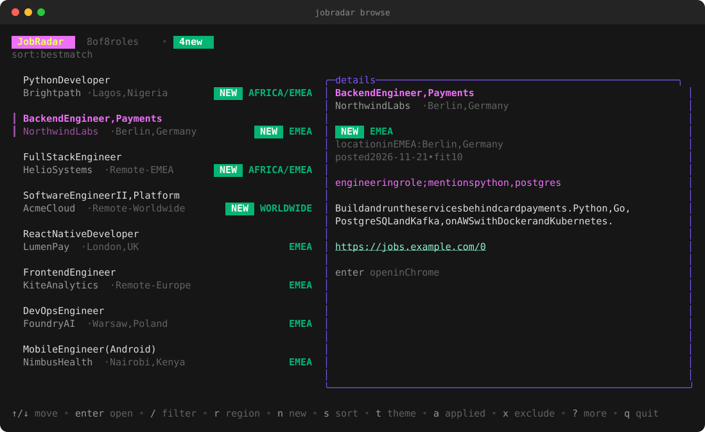
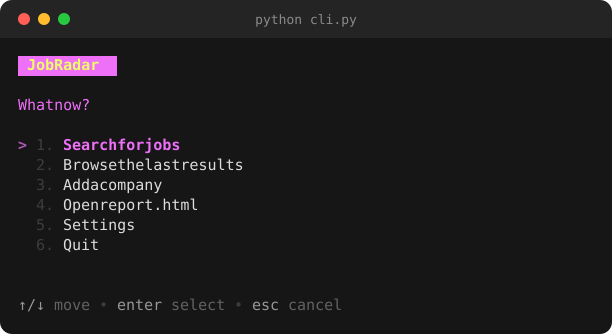
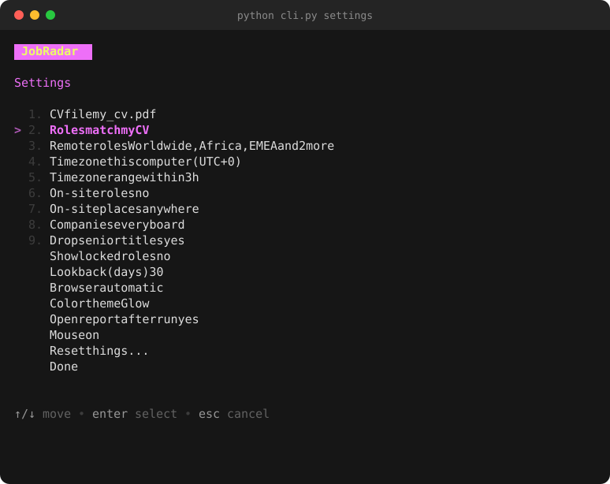
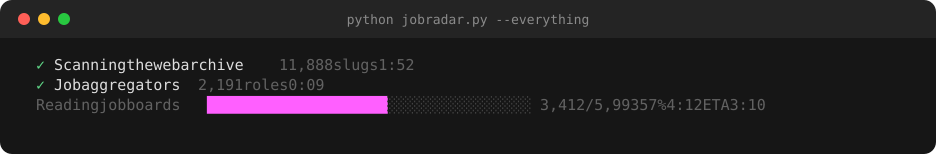
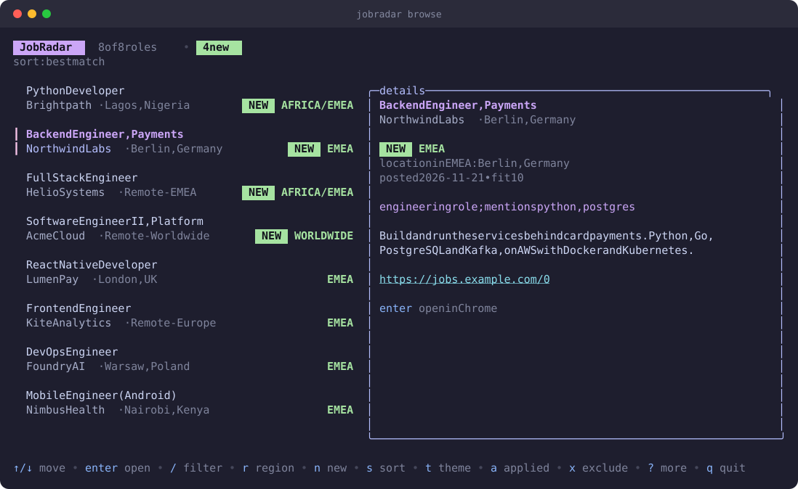
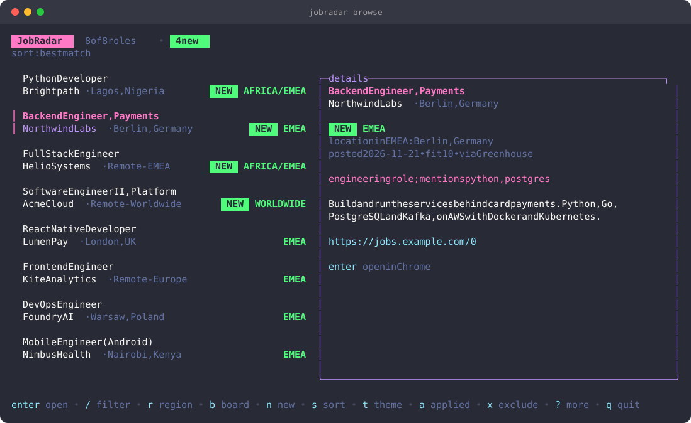
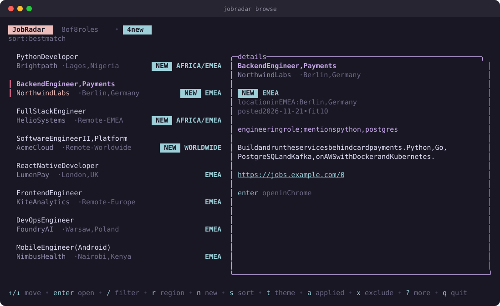
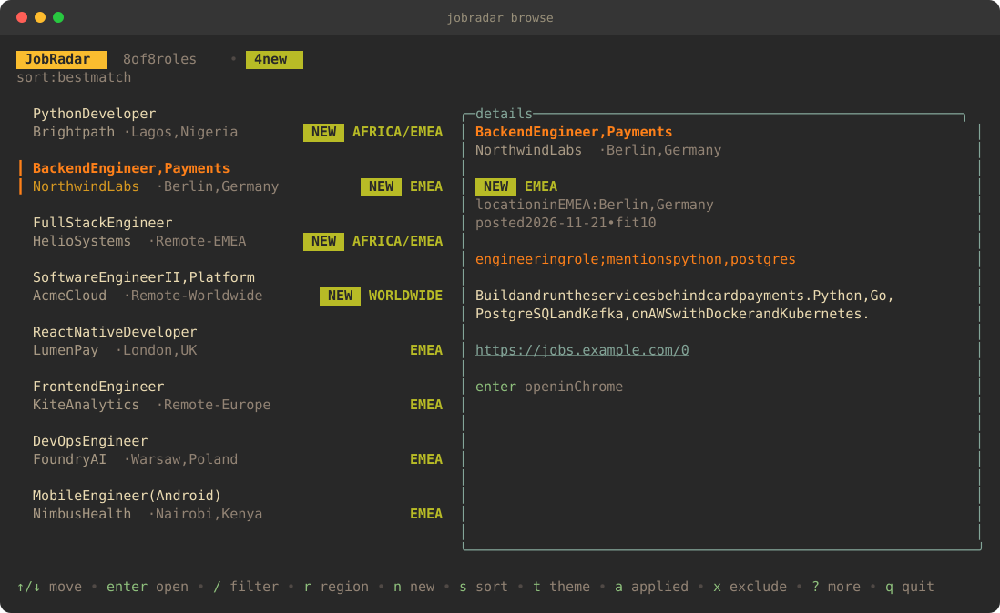

# Job Radar

**Find remote and EMEA jobs across thousands of companies, in one place, from your terminal.**

Job Radar reads the job boards that companies publish themselves, keeps the roles that fit you, and shows them in a full-screen browser or a web page. It is free, needs no account or API key, and has nothing to install except Python.

> **Credit.** Job Radar started as [OsasDTEch/jobradar](https://github.com/OsasDTEch/jobradar). The idea, the job-board readers, the region check, the fit score and the first report are all from that project. This version builds on it. See [Credits](#credits).

<p align="center">
  
</p>

---

## Contents

- [What it does](#what-it-does)
- [Quick start](#quick-start)
- [Three ways to look at your results](#three-ways-to-look-at-your-results)
- [Make it yours: settings](#make-it-yours-settings)
- [Find more jobs](#find-more-jobs)
- [Start over: reset](#start-over-reset)
- [If a search is stopped](#if-a-search-is-stopped)
- [How it decides what to show](#how-it-decides-what-to-show)
- [Themes](#themes)
- [Command line cheat sheet](#command-line-cheat-sheet)
- [Windows and PowerShell](#windows-and-powershell)
- [Troubleshooting](#troubleshooting)
- [Run it every morning](#run-it-every-morning)
- [Files in this project](#files-in-this-project)
- [Contributing and tests](#contributing-and-tests)
- [Credits](#credits)
- [License](#license)

---

## What it does

1. **Collects jobs** from the public job boards behind [Greenhouse](https://boards-api.greenhouse.io), [Lever](https://api.lever.co/v0/postings) and [Ashby](https://api.ashbyhq.com/posting-api/job-board), plus the job sites Remotive, Arbeitnow, Jobicy, Himalayas, RemoteOK and Hacker News "Who is hiring?".
2. **Keeps the ones that fit you.** You choose the kind of role, the region, and how far back to look. Roles you have applied to, and companies you have ruled out, never show up.
3. **Scores them against your CV**, so you can see which roles match the skills you actually have.
4. **Shows you what is new** since the last time you looked.

It never applies for anything. It only finds and sorts.

---

## Quick start

You need **Python 3.10 or newer**. Nothing else.

**1. Install it.** Pick one way.

The easiest is [pipx](https://pipx.pypa.io) or [uv](https://docs.astral.sh/uv/). Either one installs Job Radar as a command, in its own space, so it can't clash with anything else on your computer:

```bash
pipx install "jobradar[pdf] @ git+https://github.com/Desmond123-arch/jobradar.git"
# or
uv tool install "jobradar[pdf] @ git+https://github.com/Desmond123-arch/jobradar.git"
```

`[pdf]` adds PDF CV reading. On Windows, use `[all]` to also get the full-screen browser. To update later, run `pipx upgrade jobradar` or `uv tool upgrade jobradar`. To remove it, run `pipx uninstall jobradar` or `uv tool uninstall jobradar`.

Don't have pipx or uv? Plain `pip` works too, ideally inside a virtual environment:

```bash
pip install "jobradar[pdf] @ git+https://github.com/Desmond123-arch/jobradar.git"
```

Or get the code and run it from the folder:

```bash
git clone https://github.com/Desmond123-arch/jobradar.git
cd jobradar
```

**2. Start it**

```bash
jobradar            # if you installed it
python cli.py       # if you're running it from the folder
```

On macOS and Linux you may need `python3` instead of `python`. An installed copy also has `jobradar-search`, which does the same as `python jobradar.py` and takes the same flags, and `jobradar-cv cv.pdf`, which lists the skills found in your CV.

**Where your files live.** Run from the folder, everything stays in the folder, as before. Installed, your company list, settings, results and report live in `~/.jobradar` (`C:\Users\you\.jobradar` on Windows). The first run copies the starter company list there. To use a different folder, set `JOBRADAR_HOME`.

**3. Answer a few questions.** The first time, it asks about your CV, the roles you want, your region and your colors. You can change every answer later.

<p align="center">
  
</p>

**4. Choose "Search for jobs".** It asks a few more things, then runs. A progress bar shows how far along it is. When it finishes, choose **Browse the last results**.

That is all. Run it again tomorrow and anything new is marked **NEW**.

> **Reading a PDF CV** needs one small add-on, `pypdf`. Installing with `[pdf]` as above already includes it; from a folder, run `pip install pypdf`. Word (`.docx`) and text (`.txt`) CVs need nothing.

---

## Three ways to look at your results

### 1. The full-screen browser

Choose **Browse the last results** in the menu, or run `python cli.py browse`. Move with the arrow keys, and press **Enter** to open the posting in your browser.

<p align="center">
  
</p>

| Key | What it does |
|-----|--------------|
| `↑` `↓` (or `j` `k`) | Move. `PgUp` `PgDn` to page, `g` `G` for top and bottom |
| `Enter` | **Open the posting in your browser** |
| `/` | Filter as you type. Several words must all match. `"in quotes"` keeps a phrase. `-word` leaves a word out |
| `r` | Cycle the region: Africa/EMEA, EMEA, Worldwide, Check location |
| `n` | Show only new roles |
| `s` | Cycle the sort: best match, fit score, newest, company |
| `a` | Mark as applied. It is saved and hidden from now on |
| `x` | Exclude this company for good |
| `t` | Change the color theme |
| `c` | Clear all filters |
| `d` | Hide or show the details panel (it needs a wide window) |
| `?` | Show every key |
| `Esc` | Clear the filters, then quit. `q` quits straight away |

### 2. The web report

Every search writes **`report.html`**: a page you open in any browser, with search, filters, sorting and a card or table view. Roles show a **CV %** badge when you have set a CV. Turn on **Open report after run** in Settings and it opens by itself when a search finishes.

<p align="center">
  
</p>

### 3. Plain data

`jobs.json` holds the same roles as data, if you want to sort or filter them with your own tools.

---

## Make it yours: settings

Choose **Settings** in the menu, or run `python cli.py settings`. Everything is saved to a file called `settings.json`, so you never have to edit it by hand.

<p align="center">
  
</p>

| Setting | What it does | Choices |
|---------|--------------|---------|
| **CV file** | Your CV. Jobs are scored against the skills in it, and the role filter follows them | Pick from the list it finds, or paste a path |
| **Roles** | Which job titles to keep | AI and engineering · match my CV · web and software · every role |
| **Region** | Where the job can be | Africa and worldwide remote · all of EMEA |
| **Companies** | How wide to search | `companies.txt` only · plus job sites · every board it can find |
| **Drop senior titles** | Hide senior, staff, lead and manager roles | yes / no |
| **Show locked roles** | Also show roles limited to places you cannot work from | yes / no |
| **Look back (days)** | How old a posting can be | 1 to 365, default 30 |
| **Browser** | Which browser opens links | automatic, `chrome`, `default`, or your own command |
| **Color theme** | The look of the terminal screens | [seven themes](#themes) |
| **Open report after run** | Open `report.html` when a search finishes | yes / no |

**Choosing your CV.** The picker looks for files with "cv" or "resume" in the name in this folder, your home folder, Downloads, Documents and Desktop (and the Windows side if you use WSL), newest first. Pick one, or paste a path. Windows paths such as `C:\Users\me\Downloads\cv.pdf` work. It reads the file straight away and shows the skills it found, so you know it worked.

**Good to know.**
- Anything you type on the command line beats the settings file. `--no-settings` ignores the file for one run.
- A missing or wrong value falls back to the default. A typo cannot stop a search.
- `settings.example.json` shows what the file looks like.

---

## Find more jobs

Job Radar searches in three layers. Use as many as you like.

| Layer | What it covers | How to use it |
|-------|----------------|---------------|
| **Your list** | The companies in `companies.txt` | Paste a careers-page URL per line, or choose **Add a company** in the menu |
| **Job sites** | Remotive, Arbeitnow, Jobicy, Himalayas, RemoteOK and Hacker News | Settings → Companies → *plus job sites* |
| **Every board** | Thousands of companies, found for you | Settings → Companies → *every board* |

**Adding a company by hand.** Open `companies.txt` and add one line per company. The part after `|` is optional.

```
https://jobs.ashbyhq.com/somecompany | Some Company
https://jobs.lever.co/othercompany
https://job-boards.greenhouse.io/thirdcompany
```

To find the right address, open a job posting and click Apply. If the address starts with `jobs.ashbyhq.com`, `jobs.lever.co` or `job-boards.greenhouse.io`, that is the one.

**"Every board" explained.** None of the three platforms lets you search all their companies at once, so Job Radar finds company names from the Internet Archive's record of their pages, then checks each one. Many guesses are not real boards, and those are skipped quietly. The first scan takes a few minutes. After that the list is saved for 30 days.

**Keep track.** Add a line to `applied.txt` as `Company | Job title`, or press `a` in the browser, and that role never appears again. Add a company name to `exclude.txt`, or press `x`, to skip it completely.

---

## Start over: reset

Want a clean slate? Choose **Settings → Reset things...**, or run it from the command line:

```bash
python cli.py reset              # pick from a list
python cli.py reset seen         # or name what to reset
python cli.py reset all --yes    # --yes skips the "are you sure?" question
```

It always shows you exactly what it is about to do and asks first. Pressing Enter at the question means **no**.

| Reset | What it does |
|-------|--------------|
| `seen` | Forgets what you have seen, so every role shows as **NEW** again |
| `results` | Deletes the last results and report |
| `cache` | Deletes the saved list of boards, so the next search scans for them again |
| `settings` | Puts your settings back to the defaults |
| `applied` | Empties your applied list |
| `excluded` | Empties your excluded companies |
| `companies` | Restores the starter company list (installed copies only) |
| `all` | All of the above |

**Your work is not lost.** Before changing your settings, applied list, excluded list or company list, Job Radar copies each one to a `.bak` file next to it (`settings.json.bak`, `applied.txt.bak`, and so on), so one undo is always there. The files it can rebuild itself (results, the seen list, the board cache) are simply deleted. Your CV is never touched, and neither is `companies.txt` unless you ask for `companies`.

---

## If a search is stopped

You can press **Ctrl+C** during a search, or close the window, at any time.

- **Ctrl+C** stops it within a few seconds (it lets the requests already under way finish), says *"Stopped. Your results, seen list and settings are as they were."*, and leaves your files exactly as they were. Nothing is half-saved.
- **Closing the window** works the same way. Every file is saved in one step: a temporary copy is written first, then swapped in. So a file is either the old complete one or the new complete one, never a cut-off mix.
- **Results are saved at the very end.** A search stopped half way gives you no new results, but costs you nothing. Run it again. If it had already finished scanning for boards, that list is kept, so the second run is quicker.
- **The seen list is saved last.** If a run is cut off just before it, those roles simply show as **NEW** again, instead of being marked "seen" without you ever having been shown them.
- **If a file is ever damaged** anyway (a power cut, a full disk), Job Radar does not crash. It moves the bad `seen.json` aside as `seen.json.damaged`, tells you in the results, and carries on as if it were a first run.

---

## How it decides what to show

```
 your list ─┐
 job sites ─┼─►  collect jobs  ─►  keep roles that fit  ─►  check the place  ─►  score  ─►  show
 all boards ┘                       (title, how recent,       (is it open to      (skills
                                    not applied/excluded)     your region?)       on your CV)
```

Each role gets a label for where it can be done:

| Label | Meaning |
|-------|---------|
| **Open to Africa / EMEA** | The location names Africa, Nigeria, EMEA or a nearby place |
| **EMEA** | Located somewhere in Europe, the Middle East or Africa |
| **Worldwide** | Says "anywhere" and the description agrees |
| **Check location** | Says "Remote" with no region. Read the posting |
| *Region locked, On-site* | Hidden unless you turn on **Show locked roles** |

Labels come from the posting's own words and can be wrong. Open the posting and check before you apply.

**Progress.** A long search shows a live bar for each step, with a count and a time estimate.

<p align="center">
  
</p>

---

## Themes

Seven color themes. The default, **Glow**, uses the colors from [Charm's Glow](https://github.com/charmbracelet/glow). Choose **Color theme** in Settings and the screen changes to each theme as you move over it, with a small sample list underneath, so you can see it before you decide. `Enter` keeps it and `Esc` puts the old one back. You can also press `t` while browsing to flip through them. Your pick is remembered.

<table>
  <tr>
    <td><br><sub>Catppuccin Mocha</sub></td>
    <td><br><sub>Tokyo Night</sub></td>
  </tr>
  <tr>
    <td><br><sub>Dracula</sub></td>
    <td><br><sub>Rosé Pine</sub></td>
  </tr>
  <tr>
    <td><br><sub>Gruvbox Dark</sub></td>
    <td><br><sub>Nord</sub></td>
  </tr>
</table>

Run `python cli.py themes` to see all seven side by side in your browser, using your own results. A terminal can only show 256 colors, so each theme is the closest match and looks a touch different from these pictures.

---

## Command line cheat sheet

Most people never need these, because the menu and settings cover them. They are here for scripts and for people who like flags.

```bash
python jobradar.py                   # search using your saved settings
python jobradar.py --emea --days 7   # EMEA roles from the last week
python jobradar.py --everything      # all roles in EMEA, from every board and job site
python jobradar.py --open            # open report.html when it finishes
```

| Flag | Effect |
|------|--------|
| `--days N` | Look back N days (default 30) |
| `--roles ai\|cv\|web` | Which titles to keep. `cv` follows the skills on your CV. `web` is backend, frontend, full-stack and software engineer |
| `--any-role` | Keep every kind of role |
| `--emea` | Keep roles located anywhere in Europe, the Middle East or Africa |
| `--no-senior` | Drop senior, staff, principal, lead and manager titles |
| `--all` | Also show region-locked and on-site roles |
| `--discover` | Also read every board found by discovery |
| `--refresh-discovery` | Scan for boards again now, instead of using the saved list |
| `--aggregators` | Also read the job sites |
| `--agg-pages N` | Pages to read per job site (default 5) |
| `--cv PATH` / `--no-cv` | Score against this CV / ignore any CV |
| `--everything` | Same as `--discover --aggregators --emea --any-role` |
| `--open` | Open the report in your browser when done |
| `--workers N` | Parallel requests (default 16) |
| `--out PATH` | Write the report somewhere else |
| `--no-settings` | Ignore `settings.json` for this run |

The menu has shortcuts too: `python cli.py browse`, `settings`, `themes`, `reset`, and `--plain` for simple numbered questions instead of the full-screen menu.

---

## Windows and PowerShell

Job Radar works in Windows PowerShell, Windows Terminal and cmd.

- **Install it** with `pipx install "jobradar[all] @ git+https://github.com/Desmond123-arch/jobradar.git"` (the `[all]` includes the full-screen library and PDF reading), then start it with `jobradar`. Or run it from the folder with `python cli.py`.
- **Full-screen mode.** Windows Python does not include the screen library the full-screen browser uses. `[all]` adds it. From a folder, run `pip install windows-curses`. Or do nothing: **Browse** then opens the web report in your browser instead, which has the same search and filters.
- **Auto-open.** Turn on **Open report after run** in Settings and the report opens in Chrome (or your default browser) when a search finishes.
- **The loader** works in Windows Terminal and PowerShell. On an old console that cannot show block characters it draws a plain `####----` bar instead of failing.
- **WSL users.** Links open in your Windows Chrome automatically.
- **Which browser opens.** Leave it on *automatic*, or set **Browser** in Settings to `chrome`, `default`, or a command. `python openurl.py` shows what it picked.

---

## Troubleshooting

**"No matching roles."** Widen the net: raise **Look back (days)**, turn on **Show locked roles**, switch **Roles** to *every role*, or set **Companies** to *every board*.

**"`jobradar` is not recognized" or "command not found".** pipx and uv put commands in a folder your terminal may not know yet. Run `pipx ensurepath` (or `uv tool update-shell`), then open a new terminal window. Until then, `python cli.py` from the folder always works.

**"Where did my settings and results go?"** An installed copy keeps them in `~/.jobradar` (`C:\Users\you\.jobradar` on Windows), not in the folder you ran it from. The path of `report.html` is printed at the end of every search, so you can see the exact folder there.

**"It can't read my PDF."** Run `pip install pypdf` (or reinstall with `[pdf]`). Or save your CV as a `.docx` or `.txt` file.

**"The first search is very slow."** That is the one-time scan of thousands of boards. It is saved for 30 days, and later searches are much faster.

**"Pressing Enter does nothing."** Your browser setting may be wrong. Open Settings and set **Browser** to `default`.

**"The colors look wrong."** Try another theme, or use a terminal with 256 colors. Windows Terminal, iTerm2, GNOME Terminal and most others have them.

**"I see odd characters instead of a progress bar."** Set the environment variable `NO_COLOR=1` for plain lines.

**"I want to start fresh."** Use [reset](#start-over-reset): `python cli.py reset`. It asks first and keeps a `.bak` of your lists.

**"I stopped a search part way."** Nothing is lost or broken. See [If a search is stopped](#if-a-search-is-stopped).

---

## Run it every morning

The included workflow (`.github/workflows/radar.yml`) runs on GitHub every day at 06:37, runs the tests, fetches the boards and saves a fresh `report.html` and `jobs.json` back to your repository.

> **Keep your copy private.** The results and your `applied.txt` are personal.

1. Make your own **private** copy of this repository on GitHub.
2. Push your `companies.txt` and, if you like, `applied.txt`.
3. The workflow starts by itself. It needs no secrets.

Your `settings.json` stays on your computer, so the daily run uses the standard settings. To change them, add flags to the `python jobradar.py` line in the workflow file.

---

## Files in this project

| File | What it is |
|------|------------|
| `cli.py` | The menu. Start here |
| `tui.py` | The full-screen browser and the arrow-key menus |
| `jobradar.py` | The search itself. Also runs on its own |
| `settings.py` | Reads and writes your settings, finds your CV |
| `cvmatch.py` | Reads your CV and scores jobs against it |
| `openurl.py` | Opens links in the right browser |
| `paths.py` | Decides where your files live, and saves files safely so a stopped run can't damage them |
| `reset.py` | Puts things back to a fresh start, keeping a `.bak` of your lists |
| `entry.py` | The commands `jobradar`, `jobradar-search` and `jobradar-cv` |
| `pyproject.toml` | What makes it installable with pipx, uv or pip |
| `companies.txt` | Companies to search. Yours to edit |
| `applied.txt` | Roles you applied to. One `Company \| Title` per line |
| `exclude.txt` | Companies to skip |
| `settings.json` | Your settings. Not shared |
| `settings.example.json` | A starting copy |
| `report.html`, `jobs.json`, `seen.json`, `discovered.json` | Created for you. Not shared |
| `*.bak`, `*.damaged` | Safety copies made by reset, or of a damaged file. Safe to delete |
| `docs/images/` | The pictures in this README |
| `tests/` | The tests |

---

## Contributing and tests

Pull requests are welcome. Please:

- Keep it **free of extra installs**. The project uses only what comes with Python (PDF reading is optional).
- Add a test with any change. The tests use made-up data and never touch the network.
- If you add a new job board, add test data for it like the Greenhouse, Lever and Ashby ones.

Run the tests from the project folder:

```bash
python -m unittest
```

To work on it as an installed command that follows your edits, run `pip install -e ".[all]"`.

---

## Credits

- **[OsasDTEch](https://github.com/OsasDTEch)** created Job Radar. The original project is at **https://github.com/OsasDTEch/jobradar**. The idea, the Greenhouse, Lever and Ashby readers, the Africa and EMEA region check, the fit score, the applied and excluded lists, and the first report all come from there.
- Jobs come from the public job-board pages of Greenhouse, Lever and Ashby, and from Remotive, Arbeitnow, Jobicy, Himalayas, RemoteOK and Hacker News. Company names are found with the help of the Internet Archive.

---

## License

MIT, the license named in the original project's README. If you share this project, please keep the credit to the original author.
